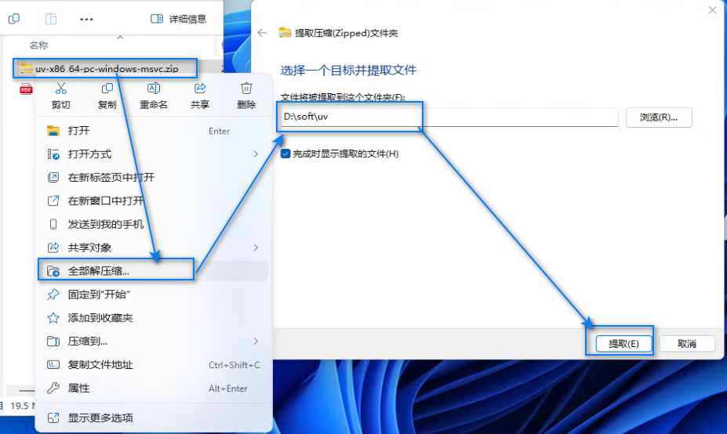
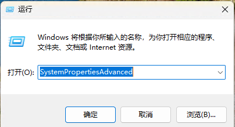
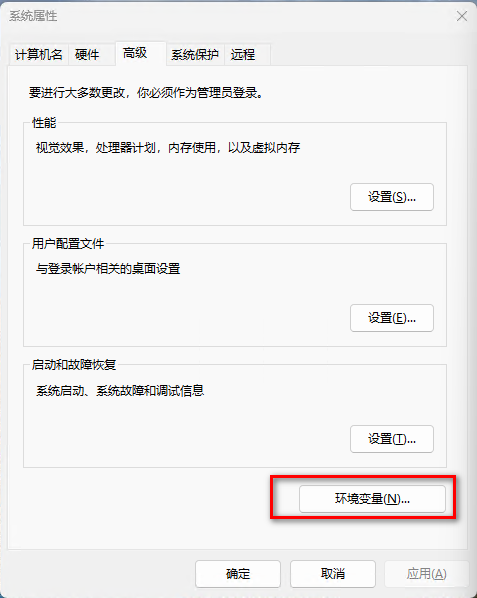
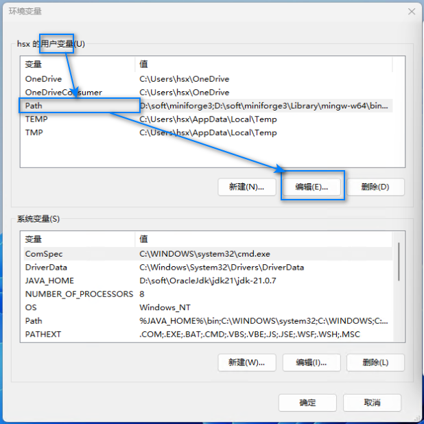
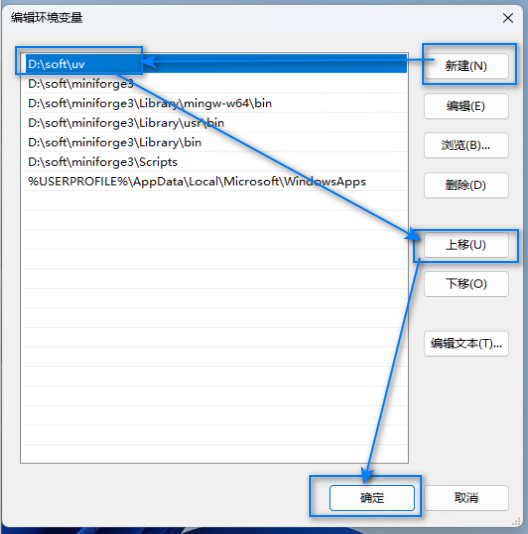
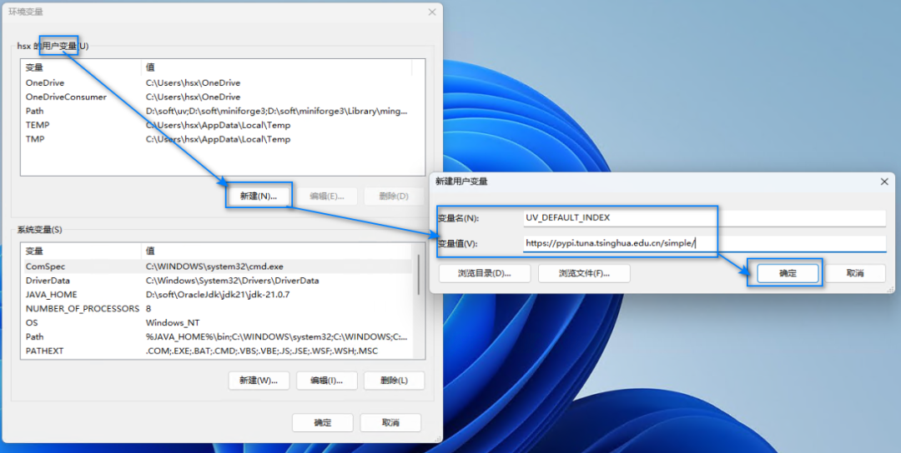
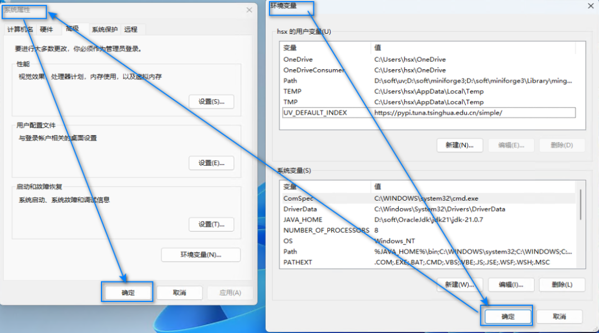
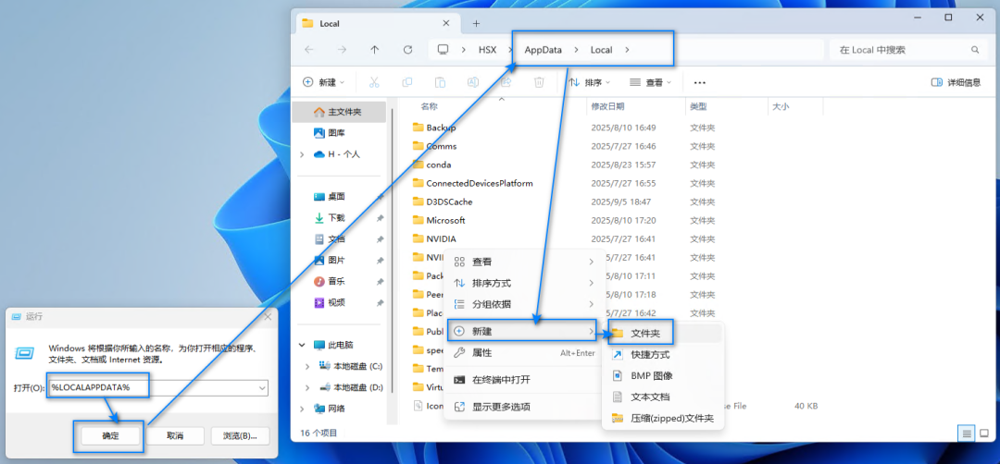
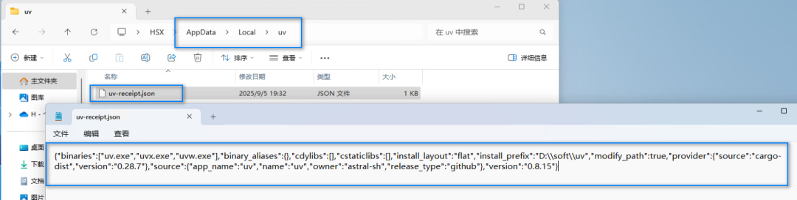

# Manual Installation and Configuration of UV 0.11.29 on Windows with a Local Source Including the Installer and Installation Guide

>

There are various methods for installing UV. You can choose any method you prefer to install it, **and there is no need to follow this tutorial**.

You can try to execute the following two commands to automatically install, if it fails, then manually install according to this article.

```
# Install uv (This command will fetch the installation script from the uv official website, then download the uv executable file from GitHub, install uv to D:\soft\uv, and finally configure Path and create a receipt file)
powershell -ExecutionPolicy ByPass -c {$env:UV_INSTALL_DIR = "D:\soft\uv";irm https://astral.sh/uv/install.ps1 | iex}
# Configure the domestic source
[Environment]::SetEnvironmentVariable("UV_DEFAULT_INDEX", "https://pypi.tuna.tsinghua.edu.cn/simple/", "User")
```

**If the above two commands are executed successfully, there is no need to continue reading.**

0. Download uv

It contains:

```
Windows manual installation and downloading configuration for uv 0.11.29, including the domestic source with the installation package and installation tutorial.zip
├── Windows installation: manually download and configure the domestic source for uv.md
    └── uv-x86_64-pc-windows-msvc.zip
```

Download the `Windows Installation uv: Manual Download, Configure Domestic Source.zip` and right-click, select "Extract All", unzip to the current folder.

Enter the `Windows Install uv: Manual Download, Configure Domestic Sources` folder and find the `uv-x86_64-pc-windows-msvc.zip` file.

1. Installation and configuration of uv

1.

1. Right-click on the compressed file `uv-x86_64-pc-windows-msvc.zip` in the integrated package, select "Extract All", enter the target path `D:\soft\uv`, and click "Extract".



Unzip.png

1.

2. Press the Win + R key, enter SystemPropertiesAdvanced, press Enter to open "Advanced System Settings".

>

Alternatively, you can also achieve the same effect by clicking on the Start button under the desktop -> Settings -> System -> System Properties -> Advanced System Settings.



winR.png

1.

3. In the pop-up "System Properties" window, click on "Environment Variables".



Environment variables.png

1.

4. Find the `Path` variable in "... User Variables (U)" and click on "Edit".



Path.png

1.

5. Click "New", enter `D:\soft\uv`, select and click "Up" to move it to the top of the list (ensure priority is used), then click "OK".



uv_Path.png

1.

6. **Configure the domestic source**, the method is as follows:



Domestic source.png

-

• Under "... User Variables (U)", click "New"

-

• Variable name fill: `UV_DEFAULT_INDEX`

-

• Variable values: `https://pypi.tuna.tsinghua.edu.cn/simple/`

-

• Click "OK"

1.

7. Click "Environment Variables" and "System Properties" windows, then click "OK" to save the settings.



Final confirmation.png

1.

8. Create a receipt file (for future updates), as follows:

-

• Press the Win + R key, enter %LOCALAPPDATA%, press Enter, it will open the local application data folder for the current user.

-

• Create a new folder named `uv`



Receipt Catalog.png

-

• Enter the newly created `uv` folder.

-

• Create a text file named `uv-receipt.json`, note to change `.txt` to `.json`.

-

• Enter the following content, save and close the file:

```
{"binaries":["uv.exe","uvx.exe","uvw.exe"],"binary_aliases":{},"cdylibs":[],"cstaticlibs":[],
"install_layout":"flat","install_prefix":"D:\\soft\\uv","modify_path":true,"provider":{"source":"cargo-dist",
"version":"0.31.0"},"source":{"app_name":"uv","name":"uv","owner":"astral-sh","release_type":"github"},
"version":"0.11.29"}
```



Receipt file.png

1.

9. Close all open terminals (PowerShell and CMD). Right-click the desktop, select "Open in Terminal", enter `uv --version`. If it outputs something like `uv 0.11.29 (8473ecba1 2026-07-03)`, then it means the installation is successful.

2. Troubleshooting and resolution

##### 2.1. Error during verification: uv: Unable to recognize "uv" as a name for a cmdlet, function, script file, or executable program

Follow the methods below to troubleshoot and resolve:

1.

1. After setting up the environment variables, it takes time to take effect; previously opened terminal windows that were configured before will not take effect.

1.

2. Check whether the actual uv unzipped path is included in the environment variable Path, and whether the characters are correctly entered.

# 2.2. Error during verification: 'uv' is not an internal or external command, nor a executable program or batch file.

Environment variable configuration issues, refer to the steps in 4.1 for troubleshooting.

##### 2.3. Error during verification: uv-version: Unable to recognize "uv-version" as a name for a cmdlet, function, script file, or executable program.

The command was incorrect; it should be `uv -version` instead of `uv-version`, with a space missing in between.


## Payment

Here is a pay link on Stripe ( https://buy.stripe.com/3cs8yP7sY87d0vu9AB ). Please contact me lonlonago@foxmail.com after funding $89, and I will send you a complete data files , thank you!


